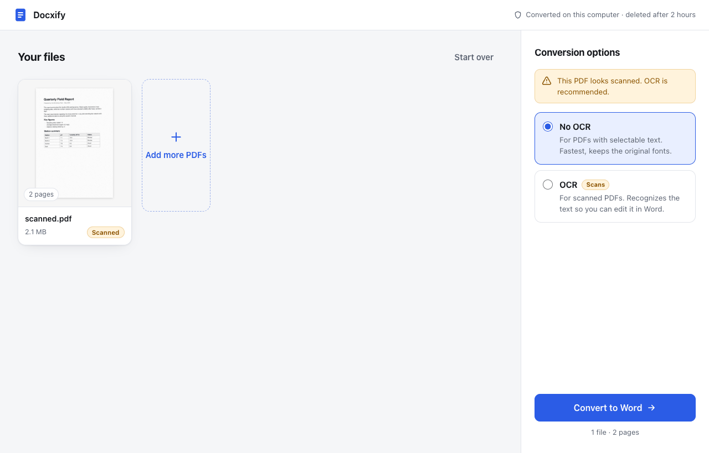

# Docxify

**Turn PDFs into editable Word documents, including scanned ones, on your own computer.**

[](https://github.com/farqani9/docxify/actions/workflows/ci.yml)
[](LICENSE)


Docxify is a self-hosted PDF → DOCX converter with built-in OCR. Drop in a PDF and get back
a Word document you can actually edit: real headings, paragraphs that reflow, bulleted lists,
tables, and a proper header and footer. Files never leave your machine.



## Features

- **Layout-faithful conversion** of text PDFs: fonts, tables, images and spacing.
- **Built-in OCR** for scanned PDFs (PP-OCRv5 via RapidOCR). It straightens pages, recognizes
  the text, rebuilds tables from their ruling lines and recovers bullet points. English and
  other Latin-script languages are supported.
- **Automatic scan detection.** Docxify spots image-only pages and offers OCR when it would
  help.
- **Word-native output:**
  - Heading 1–3 styles and real bulleted or numbered lists;
  - paragraphs that reflow instead of one hard line per PDF line;
  - continuous page flow;
  - tables rejoined across page breaks, with the header row repeating on each page;
  - repeating headers and footers rebuilt as Word headers and footers, with live page
    numbers;
  - fonts mapped to installed equivalents (for example Liberation Sans → Arial).
- **Private by default.** Everything runs locally, and uploads are deleted after 2 hours or
  on demand.
- **Simple web app** with drag and drop, several files at once (delivered as a ZIP), progress,
  and light and dark themes. There's also a small HTTP API.

## Quick start

Requires Python 3.12 and [uv](https://docs.astral.sh/uv/) (or plain `pip`).

```bash
git clone https://github.com/farqani9/docxify.git
cd docxify
uv venv --python 3.12 .venv
uv pip install --python .venv/bin/python -r requirements.txt
.venv/bin/uvicorn server.app:app --port 8000
```

Open <http://127.0.0.1:8000> and drop in a PDF.

The first OCR run downloads the PP-OCRv5 model files (a few MB). After that, Docxify works
fully offline.

## Scanned PDFs

When a PDF has no text layer, Docxify asks whether to apply OCR. Without OCR, scanned pages
go into Word as images. With OCR you get editable text:


## How it works

1. **Upload.** Files are sent in 2 MB chunks. Each page is checked: pages with almost no
   extractable text that are covered by images count as scanned.
2. **OCR (optional, for scanned pages).** Each page is rendered at 200 dpi and deskewed,
   then its text is recognized. Each page is rebuilt as a clean text page: ink-tight line
   positions, clustered font sizes, recovered bullets and redrawn table rules.
3. **Layout conversion.** [pdf2docx](https://github.com/ArtifexSoftware/pdf2docx) turns the
   pages into DOCX. Running headers and footers are detected and stripped first.
4. **Clean-up** (`server/docx_fix.py`), so the file behaves like one made in Word:
   - map fonts to installed equivalents;
   - merge the page sections into one flow;
   - rejoin split tables and repeat their header rows;
   - rebuild table column widths;
   - relax fixed row heights and line spacing so text can't be clipped;
   - split bullet lists into separate items;
   - restore free-standing rules and letter spacing;
   - rebuild the header and footer;
   - make all values valid OOXML.
5. **Semantics** (`server/engine.py`). Wrapped lines are rejoined into paragraphs, Heading
   1–3 styles come from font-size ranks, list styles are applied, and the document title is
   set.

## HTTP API

The web UI is a thin client over a small task API:

```bash
TASK=$(curl -s -X POST localhost:8000/v1/start | jq -r .task)
SF=$(curl -s -F task=$TASK -F file=@report.pdf localhost:8000/v1/upload | jq -r .server_filename)
curl -s -F task=$TASK -F ocr=1 \
     -F "files[0][server_filename]=$SF" -F "files[0][filename]=report.pdf" \
     localhost:8000/v1/process
curl -o report.docx localhost:8000/v1/download/$TASK
```

| Method | Path | Notes |
|---|---|---|
| `POST` | `/v1/start` | Creates a task, returning `{task, limits, ocr_languages}` |
| `POST` | `/v1/upload` | Multipart: `task`, `file`, plus optional `uid`, `name`, `chunk`, `chunks` for chunked uploads. Returns `{server_filename, scanned, pages, scanned_pages, thumbnail}` |
| `POST` | `/v1/process` | `task`, `ocr=0\|1`, `ocr_lang=en\|latin`, `output_filename={filename}`, `packaged_filename`, `files[i][server_filename]`, `files[i][filename]` |
| `GET` | `/v1/task/{task}` | Status and progress `{stage, file, files, done, total, percent}` |
| `GET` | `/v1/download/{task}` | The `.docx`, or a `.zip` for several files |
| `GET` | `/v1/thumbnail/{task}/{file}` | First-page preview (PNG) |
| `DELETE` | `/v1/upload/{task}/{file}` | Removes one uploaded file |
| `DELETE` | `/v1/task/{task}` | Deletes the whole task now |

Interactive docs are at <http://127.0.0.1:8000/api/docs>.

## Configuration

Settings are environment variables:

| Variable | Default | Meaning |
|---|---|---|
| `DOCXIFY_DATA_DIR` | `./data` | Where uploads and results are stored |
| `DOCXIFY_TTL_SECONDS` | `7200` | How long files are kept before they're deleted automatically |
| `DOCXIFY_MAX_FILE_MB` | `100` | Maximum size per PDF |
| `DOCXIFY_MAX_FILES` | `10` | Maximum files per conversion |
| `DOCXIFY_MAX_PAGES` | `300` | Maximum pages per PDF |
| `DOCXIFY_WORKERS` | `2` | How many conversions can run at the same time |

Docxify listens on `127.0.0.1` and has no authentication. See [SECURITY.md](SECURITY.md)
before exposing it to a network.

## Development

```bash
.venv/bin/python tests/make_fixtures.py     # generate synthetic digital + scanned PDFs
.venv/bin/python tests/check_engine.py      # structure, layout and OCR-accuracy checks
.venv/bin/python tests/check_feedback.py    # re-check your private cases in feedback/
npm install && npx playwright install chromium
npm run test:e2e                            # browser end-to-end test (server running)
```

```
server/engine.py     scan detection, OCR, layout conversion, semantics
server/layout.py     running header/footer and free-standing rule detection
server/docx_fix.py   DOCX clean-up (fonts, flow, tables, bullets, header/footer)
server/app.py        FastAPI task API and static web app
web/                 single-page UI (no build step)
tests/               fixtures, engine checks, end-to-end test
feedback/            local, git-ignored regression cases
```

Contributions are welcome. See [CONTRIBUTING.md](CONTRIBUTING.md).

## Limitations

- Bold and italic aren't recovered from scans. Headings are still detected, from font size.
- Images inside scanned pages are dropped in OCR mode, which keeps only text and tables.
- Multi-column scans, handwriting and right-to-left scripts aren't supported yet.
- Layout fidelity on complex digital PDFs depends on pdf2docx, and very dense layouts may
  need touch-ups.

## License

Docxify is free software, licensed under the
[GNU Affero General Public License v3.0 or later](LICENSE). Copyright © 2026 the Docxify
authors.

It's built on these projects:

| Project | License |
|---|---|
| [PyMuPDF](https://github.com/pymupdf/PyMuPDF) | AGPL-3.0 (or commercial). This is why Docxify is AGPL |
| [pdf2docx](https://github.com/ArtifexSoftware/pdf2docx) | MIT |
| [RapidOCR](https://github.com/RapidAI/RapidOCR) and the PaddleOCR PP-OCR models | Apache-2.0 |
| [python-docx](https://github.com/python-openxml/python-docx) | MIT |
| [OpenCV](https://opencv.org/), [ONNX Runtime](https://onnxruntime.ai/) | Apache-2.0 / MIT |
| [FastAPI](https://fastapi.tiangolo.com/), [Uvicorn](https://www.uvicorn.org/) | MIT / BSD-3-Clause |
