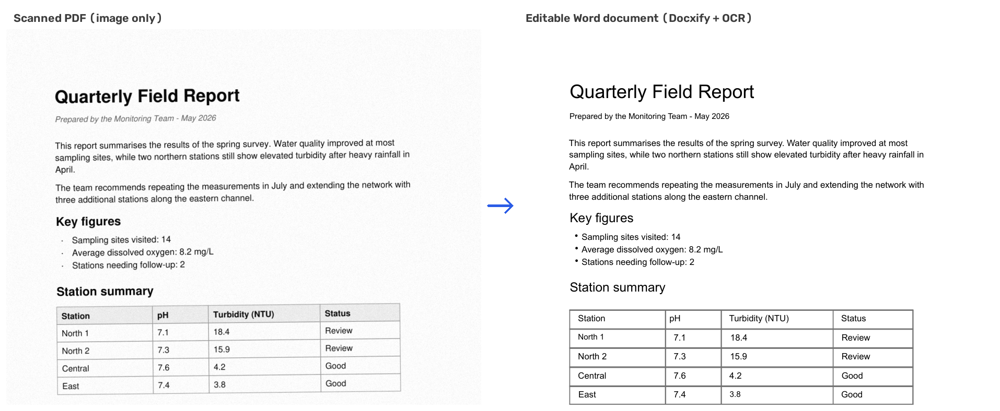

# Docxify

**Turn PDFs into editable Word documents, including scanned ones, on your own computer.**

[](https://github.com/farqani9/docxify/actions/workflows/ci.yml)
[](LICENSE)


Docxify is a self-hosted PDF → DOCX converter with built-in OCR. Drop in a PDF and get back
a Word document you can actually edit: real headings, paragraphs that reflow, bulleted lists,
tables, and a proper header and footer. Files never leave your machine.

> **Current release: 1.1**, which adds Arabic OCR and right-to-left documents. Features
> marked *(1.1)* below are new in it. See [Versions](#versions).


## Features

- **Layout-faithful conversion** of text PDFs: fonts, tables, images and spacing.
- **Built-in OCR** for scanned PDFs (PP-OCRv5 via RapidOCR). It straightens pages, recognizes
  the text, rebuilds tables (very light borders, coloured header rows and banners
  included), keeps pictures and logos as images, rebuilds running headers and footers,
  and recovers bullet points. Supported
  languages: English, other Latin-script languages, and Arabic *(1.1)*.
- **Arabic and right-to-left text** *(1.1)*, from scans and from digital PDFs. Paragraphs come out
  right to left in Word, in correct reading order, with numbers and Latin words such as
  "pH" kept in place.
- **Proofreading aid.** Optionally, text the OCR read with low confidence is highlighted
  in yellow (whole lines, or single words in Arabic), and the summary says how much.
- **Automatic scan detection.** Docxify spots image-only pages and offers OCR when it would
  help.
- **Word-native output:**
  - Heading 1–3 styles and real bulleted or numbered lists;
  - paragraphs that reflow instead of one hard line per PDF line;
  - continuous page flow;
  - tables rejoined across page breaks, with the header row repeating on each page;
  - repeating headers and footers rebuilt as Word headers and footers, with live page
    numbers;
  - fonts mapped to installed equivalents (for example Liberation Sans → Arial).
- **Private by default.** Everything runs locally, and uploads are deleted after 2 hours or
  on demand.
- **Simple web app** with drag and drop, several files at once (delivered as a ZIP), progress,
  and light and dark themes. There's also a small HTTP API.

## Quick start

Requires Python 3.12 and [uv](https://docs.astral.sh/uv/) (or plain `pip`).

```bash
git clone https://github.com/farqani9/docxify.git
cd docxify
uv venv --python 3.12 .venv
uv pip install --python .venv/bin/python -r requirements.txt
.venv/bin/uvicorn server.app:app --port 8000
```

Open <http://127.0.0.1:8000> and drop in a PDF.

The first OCR run downloads the PP-OCRv5 model files (a few MB). After that, Docxify works
fully offline.

## Scanned PDFs

When a PDF has no text layer, Docxify asks whether to apply OCR. Without OCR, scanned pages
go into Word as images. With OCR you get editable text:



## Arabic documents *(1.1)*

Digital Arabic PDFs need no setting: right-to-left lines are found automatically. For a
scanned Arabic PDF, turn on OCR and pick **Arabic (العربية)** as the text language (API:
`ocr_lang=ar`).

The Arabic OCR model reads Arabic well but drops digits and Latin letters, so each Arabic
line is re-read word by word with both the Arabic and the English model, and the better
reading is kept for each word. In Word, paragraphs, runs and the section are marked
right to left, and Arabic text uses complex-script fonts and sizes (Arial or Times New
Roman), so it displays correctly in Word, Pages and LibreOffice.

## How it works

1. **Upload.** Files are sent in 2 MB chunks. Each page is checked: pages with almost no
   extractable text that are covered by images count as scanned.
2. **OCR (optional, for scanned pages).** Each page is rendered at 200 dpi and deskewed,
   then its text is recognized. Each page is rebuilt as a clean text page: ink-tight line
   positions, clustered font sizes, recovered bullets and redrawn table rules.
   Right-to-left lines are written as placeholders sized to the original line, so the
   layout step can't reorder their characters.
3. **Layout conversion.** [pdf2docx](https://github.com/ArtifexSoftware/pdf2docx) turns the
   pages into DOCX. Running headers and footers are detected and stripped first. In
   digital PDFs, right-to-left lines get the same placeholder treatment, with their
   reading order recovered from glyph positions by the Unicode bidi algorithm.
4. **Clean-up** (`server/docx_fix.py`), so the file behaves like one made in Word:
   - map fonts to installed equivalents;
   - merge the page sections into one flow;
   - rejoin split tables and repeat their header rows;
   - rebuild table column widths;
   - relax fixed row heights and line spacing so text can't be clipped;
   - split bullet lists into separate items;
   - restore free-standing rules and letter spacing;
   - rebuild the header and footer;
   - put right-to-left text back in place of its placeholders and mark it right to left;
   - make all values valid OOXML.
5. **Semantics** (`server/engine.py`). Wrapped lines are rejoined into paragraphs, Heading
   1–3 styles come from font-size ranks, list styles are applied, and the document title is
   set.

## HTTP API

The web UI is a thin client over a small task API:

```bash
TASK=$(curl -s -X POST localhost:8000/v1/start | jq -r .task)
SF=$(curl -s -F task=$TASK -F file=@report.pdf localhost:8000/v1/upload | jq -r .server_filename)
curl -s -F task=$TASK -F ocr=1 \
     -F "files[0][server_filename]=$SF" -F "files[0][filename]=report.pdf" \
     localhost:8000/v1/process
curl -o report.docx localhost:8000/v1/download/$TASK
```

| Method | Path | Notes |
|---|---|---|
| `POST` | `/v1/start` | Creates a task, returning `{task, limits, ocr_languages}` |
| `POST` | `/v1/upload` | Multipart: `task`, `file`, plus optional `uid`, `name`, `chunk`, `chunks` for chunked uploads. Returns `{server_filename, scanned, pages, scanned_pages, thumbnail}` |
| `POST` | `/v1/process` | `task`, `ocr=0\|1`, `ocr_lang=en\|latin\|ar` (`ar` from 1.1), `ocr_review=0\|1` (highlight low-confidence OCR text), `output_filename={filename}`, `packaged_filename`, `files[i][server_filename]`, `files[i][filename]` |
| `GET` | `/v1/task/{task}` | Status and progress `{stage, file, files, done, total, percent}` |
| `GET` | `/v1/download/{task}` | The `.docx`, or a `.zip` for several files |
| `GET` | `/v1/thumbnail/{task}/{file}` | First-page preview (PNG) |
| `DELETE` | `/v1/upload/{task}/{file}` | Removes one uploaded file |
| `DELETE` | `/v1/task/{task}` | Deletes the whole task now |

Interactive docs are at <http://127.0.0.1:8000/api/docs>.

## Configuration

Settings are environment variables:

| Variable | Default | Meaning |
|---|---|---|
| `DOCXIFY_DATA_DIR` | `./data` | Where uploads and results are stored |
| `DOCXIFY_TTL_SECONDS` | `7200` | How long files are kept before they're deleted automatically |
| `DOCXIFY_MAX_FILE_MB` | `100` | Maximum size per PDF |
| `DOCXIFY_MAX_FILES` | `10` | Maximum files per conversion |
| `DOCXIFY_MAX_PAGES` | `300` | Maximum pages per PDF |
| `DOCXIFY_WORKERS` | `2` | How many conversions can run at the same time |

Docxify listens on `127.0.0.1` and has no authentication. See [SECURITY.md](SECURITY.md)
before exposing it to a network.

## Development

```bash
.venv/bin/python tests/make_fixtures.py     # generate synthetic PDFs (English + Arabic)
.venv/bin/python tests/check_engine.py      # structure, layout and OCR-accuracy checks
.venv/bin/python tests/check_feedback.py    # re-check your private cases in feedback/
npm install && npx playwright install chromium
npm run test:e2e                            # browser end-to-end test (server running)
```

```
server/engine.py     scan detection, OCR, layout conversion, semantics
server/layout.py     running header/footer and free-standing rule detection
server/docx_fix.py   DOCX clean-up (fonts, flow, tables, bullets, header/footer)
server/app.py        FastAPI task API and static web app
web/                 single-page UI (no build step)
tests/               fixtures, engine checks, end-to-end test
feedback/            local, git-ignored regression cases
```

Contributions are welcome. See [CONTRIBUTING.md](CONTRIBUTING.md).

## Limitations

- Bold and italic aren't recovered from scans. Headings are still detected, from font size.
- In OCR mode, pictures (logos, photos, charts) are kept as images, and text inside a
  picture stays part of it. A picture that touches text closely can absorb a short line.
- Multi-column scans and handwriting aren't supported yet.
- Among right-to-left scripts, OCR covers Arabic only. Digital Hebrew, Persian or Urdu PDFs
  get right-to-left paragraphs, but they're less tested.
- On Arabic scans, font sizes are estimated from line width and height, so a heading only
  slightly larger than body text can be missed.
- OCR rebuilds tables from their ruling lines (very light ones included) and coloured
  header rows. Tables drawn with no lines or fills at all still come out as loose text.
- Layout fidelity on complex digital PDFs depends on pdf2docx, and very dense layouts may
  need touch-ups.

## Versions

### 1.1 (current release, 2026-11-21)

New:

- **Arabic OCR.** Pick "Arabic (العربية)" in the web app, or send `ocr_lang=ar` to the API.
  Each Arabic line is re-read word by word with the Arabic and English models, so digits
  and Latin words such as "pH" or "HTML5" survive. Bullet dots that the model reads as an
  Arabic zero are recognized as bullets.
- **Right-to-left digital PDFs.** Reading order is rebuilt from the glyphs as drawn,
  including harakat, lam-alef and brackets, and lines that mix Arabic with numbers and
  Latin. In Word, paragraphs, runs and the section are right to left, with complex-script
  fonts and sizes.
- **Tables.** A coloured header row that the layout converter splits off goes back on top
  of its table, and repeats on each page.
- **Lists.** Numbered lists follow the source: a new list starts at 1, and a list that
  continues after a note keeps counting. Items packed into one paragraph are split, and
  bullets that browsers draw as shapes become list items in right-to-left text.
- **Headers and footers** are found in PDFs printed from a browser, where white background
  boxes used to hide them. Arabic headers and footers keep live page numbers
  ("صفحة 2 من 5"), on scans as well.
- **Paragraphs.** A heading that wraps onto two lines becomes one paragraph. A title,
  subtitle and body packed into one paragraph are split apart.
- **Web app.** The language list fits its panel, and file counts read "1 page".

Upgrading from 1.0:

- New dependency: python-bidi (LGPL-3.0). Run `uv pip install -r requirements.txt` again.
- The first Arabic OCR run downloads the PP-OCRv5 Arabic recognition model (a few MB).
- API: `ocr_lang` accepts `ar`, and `/v1/start` lists it in `ocr_languages`. Nothing else
  changes.

Testing: synthetic English and Arabic fixtures (digital, shaped and scanned) are checked
by `tests/check_engine.py`. A real five-page Arabic proposal, which isn't in the repository,
converts page for page with the same structure, header and footer. Known gaps are listed
under [Limitations](#limitations).

### 1.0 (2026-11-21)

The first public release, tagged [`v1.0`](https://github.com/farqani9/docxify/tree/v1.0):

- PDF to DOCX conversion with layout preserved (pdf2docx), cleaned up into a Word-native
  file: heading styles, reflowed paragraphs, bulleted and numbered lists, tables rejoined
  across pages, header and footer as Word parts with live page numbers, and fonts mapped
  to installed equivalents.
- OCR for scanned PDFs in English and other Latin-script languages (PP-OCRv5).
- Automatic scan detection.
- Web app and HTTP task API. Files are deleted after 2 hours.

## License

Docxify is free software, licensed under the
[GNU Affero General Public License v3.0 or later](LICENSE). Copyright © 2026 the Docxify
authors.

It's built on these projects:

| Project | License |
|---|---|
| [PyMuPDF](https://github.com/pymupdf/PyMuPDF) | AGPL-3.0 (or commercial). This is why Docxify is AGPL |
| [pdf2docx](https://github.com/ArtifexSoftware/pdf2docx) | MIT |
| [RapidOCR](https://github.com/RapidAI/RapidOCR) and the PaddleOCR PP-OCR models | Apache-2.0 |
| [python-docx](https://github.com/python-openxml/python-docx) | MIT |
| [python-bidi](https://github.com/MeirKriheli/python-bidi) | LGPL-3.0 |
| [OpenCV](https://opencv.org/), [ONNX Runtime](https://onnxruntime.ai/) | Apache-2.0 / MIT |
| [FastAPI](https://fastapi.tiangolo.com/), [Uvicorn](https://www.uvicorn.org/) | MIT / BSD-3-Clause |
